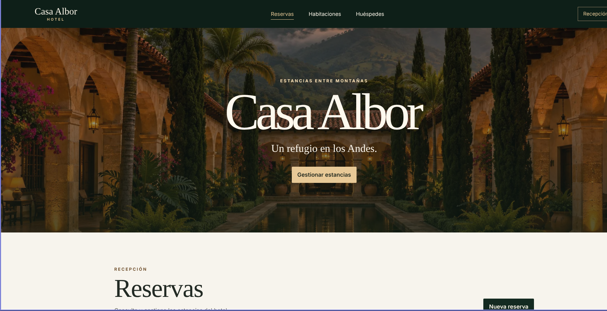
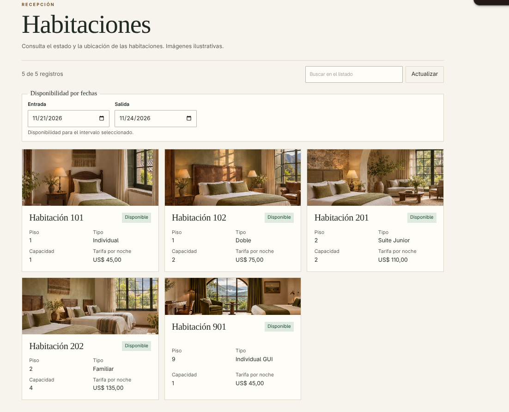
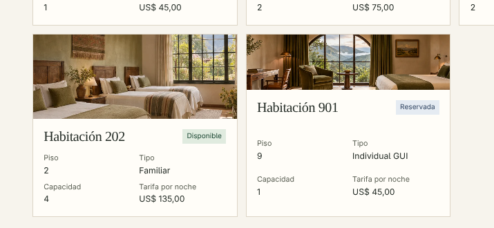
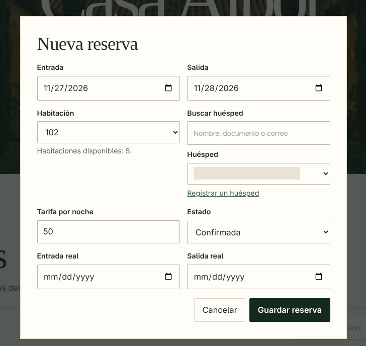
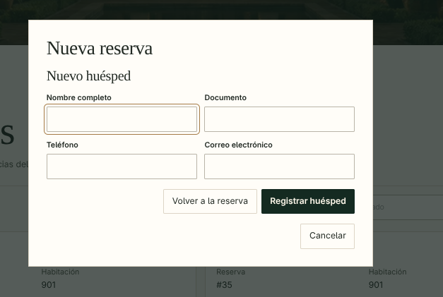

<div align="center">

# 🏨 Casa Albor
### Sistema de Gestión Hotelera

**Aplicación web para administrar huéspedes, habitaciones y reservas de un hotel.**


</div>



## Vista del sistema

| Catálogo de habitaciones | Disponibilidad por fechas |
|---|---|
|  |  |

| Nueva reserva | Registro de huéspedes desde la reserva |
|---|---|
|  |  |

Las imágenes de la interfaz corresponden a la aplicación ejecutada en un entorno de pruebas. Los datos personales se ocultaron en las capturas publicables.

## Descripción

**Casa Albor** es un sistema de gestión hotelera desarrollado como proyecto universitario de Bases de Datos. Integra una base de datos relacional **MySQL**, una **API REST en Flask** y una **interfaz web** construida con HTML, CSS y JavaScript.

Su propósito es facilitar el trabajo de recepción: consultar habitaciones, registrar huéspedes, gestionar reservas y mantener la consistencia de la información mediante reglas de validación y restricciones de integridad.

## Funcionalidades

| Módulo | Funcionalidades |
|---|---|
| **Huéspedes** | Registro, consulta, actualización y eliminación mediante la API; validación de identificación única. |
| **Habitaciones** | Catálogo de cinco habitaciones de demostración, tipos, capacidad, tarifa, estado físico y disponibilidad por fechas. |
| **Reservas** | Creación, consulta, edición, cancelación y eliminación conforme a las restricciones de la base de datos. |
| **Disponibilidad** | Consulta por intervalo de fechas; previene el solapamiento de reservas activas y excluye habitaciones fuera de servicio. |
| **Integridad** | Control de relaciones entre reservas, pagos y cargos; respuestas de error claras ante conflictos. |
| **Interfaz web** | Recepción de Casa Albor con portada, fichas de habitaciones, búsqueda de huéspedes y registro directo desde una nueva reserva. |

**Flujo de recepción:** la interfaz permite registrar un huésped desde «Nueva reserva», elegir fechas, consultar habitaciones disponibles, guardar una reserva y gestionar su edición o cancelación. La disponibilidad se calcula por fechas, y una cancelación conserva el historial y libera las noches reservadas.

## Tecnologías

- **Backend:** Python, Flask, Flask-SQLAlchemy y SQLAlchemy.
- **Base de datos:** MySQL 8.0 (InnoDB), con ejecución local mediante Docker.
- **Frontend:** HTML, CSS y JavaScript.
- **Pruebas:** pytest para API, validaciones y rutas HTTP; casos SQL documentados.
- **Control de versiones:** Git y GitHub.

## Arquitectura

```text
Navegador (HTML, CSS y JavaScript)
            |
            v
      Aplicación Flask
            |
      API REST /api
            |
     SQLAlchemy / PyMySQL
            |
         MySQL 8.0
```

La base de datos contiene **siete tablas**: `guest`, `room_type`, `room`, `reservation`, `payment`, `service` y `service_charge`.

## Estructura del repositorio

```text
Hotel-Management-System/
├── backend/
│   ├── __init__.py          # Configuración de Flask
│   ├── models.py            # Modelos y relaciones
│   ├── routes.py            # Endpoints de la API
│   ├── validation.py        # Validaciones
│   ├── templates/           # Interfaz HTML
│   ├── static/              # CSS, JavaScript y recursos visuales
│   └── tests/               # Pruebas automatizadas
├── database/
│   ├── 01_schema.sql        # Estructura de la base de datos
│   ├── 02_sample_data.sql   # Datos de demostración
│   └── 03_queries.sql       # Consultas SQL
├── tests/
│   ├── sql/                 # Casos de prueba SQL
│   └── run_all.py           # Ejecutor de pruebas SQL
├── docs/
│   ├── API_TEST_REPORT.md   # Informe de pruebas de la API
│   ├── TEST_CASES.md        # Casos de prueba SQL
│   └── evidence/            # Evidencias y resultados
├── .gitignore
├── README.md
└── backend/.env.example
```

## Instalación y ejecución

### 1. Clonar el repositorio

```bash
git clone https://github.com/dylanes20/Hotel-Management-System.git
cd Hotel-Management-System
```

### 2. Preparar Python

Se recomienda **Python 3.10 o superior**. El proyecto se ha ejecutado en Omarchy (Arch Linux) con Python 3.14.

```bash
python -m venv .venv
source .venv/bin/activate
python -m pip install -r backend/requirements.txt
```

### 3. Preparar MySQL

Se requiere un servidor MySQL 8.0 con una base de datos denominada `hotel_management`, creada a partir de `database/01_schema.sql`.

Si utilizas Docker y ya tienes un contenedor MySQL, inícialo y verifica el puerto publicado. Por ejemplo, en el entorno de desarrollo del proyecto:

```bash
docker start mysqlcontainer2
docker port mysqlcontainer2 3306/tcp
```

**Para una instalación nueva**, importa `database/01_schema.sql`. Puedes cargar `database/02_sample_data.sql` para disponer de registros ficticios de demostración. **No vuelvas a importar los datos de ejemplo en una base que ya contiene información**, porque podrían producirse duplicados. No ejecutes scripts de preparación sobre una base de producción sin revisar sus instrucciones.

### 4. Configurar la conexión

```bash
cp backend/.env.example backend/.env
```

Edita `backend/.env` con los datos de tu servidor MySQL:

```dotenv
HOTEL_API_DB_HOST=127.0.0.1
HOTEL_API_DB_PORT=3306
HOTEL_API_DB_NAME=hotel_management
HOTEL_API_DB_USER=tu_usuario_mysql
HOTEL_API_DB_PASSWORD=tu_contrasena_local
```

El usuario MySQL debe contar con los permisos necesarios sobre la base correspondiente. **No publiques `backend/.env`, contraseñas ni datos personales reales.** El archivo está excluido mediante `.gitignore`.

### 5. Iniciar la aplicación

```bash
python -m flask --app backend:create_app run
```

Abre **http://127.0.0.1:5000/** para utilizar la interfaz web.

## Catálogo de demostración

Para insertar las habitaciones de muestra **101, 102, 201 y 202** junto a la **901** ya existente, el proyecto incorpora un seed reutilizable. Debe ejecutarse **solo sobre** `hotel_management_api_test`, con las variables de conexión `HOTEL_API_TEST_DB_*` configuradas:

```bash
python -m database.seed_demo_rooms          # vista previa sin escritura
python -m database.seed_demo_rooms --apply  # insertar los registros faltantes
```

El script comprueba el destino, conserva los registros existentes y evita duplicados. Nunca debe usarse para escribir sobre la base principal.

## API REST

La aplicación expone operaciones CRUD para huéspedes, habitaciones y reservas:

| Recurso | Consultar / crear | Consultar / modificar / eliminar por ID |
|---|---|---|
| Huéspedes | `GET, POST /api/guests` | `GET, PUT, PATCH, DELETE /api/guests/<id>` |
| Habitaciones | `GET, POST /api/rooms` | `GET, PUT, PATCH, DELETE /api/rooms/<id>` |
| Reservas | `GET, POST /api/reservations` | `GET, PUT, PATCH, DELETE /api/reservations/<id>` |

Ejemplo de consulta:

```bash
curl http://127.0.0.1:5000/api/reservations
```

Las respuestas incluyen códigos HTTP adecuados, como `201` para creación, `204` para eliminación y `409` cuando una operación entra en conflicto con una restricción de integridad.

## Pruebas y resultados

### Pruebas automatizadas de la API

La ejecución realizada en el entorno local de Omarchy con la base aislada `hotel_management_api_test` obtuvo:

```text
...............................  [100%]
31 passed in 0.43s
```

Los casos cubren operaciones CRUD, validación de datos, identificación duplicada, fechas de reservas, solapamientos, habitaciones no disponibles y protección de reservas con pagos o cargos relacionados.

- [Resultado de pytest (31 pruebas)](docs/evidence/api/pytest_results_final.txt)
- [Informe de pruebas de la API](docs/API_TEST_REPORT.md)

Para volver a ejecutar las pruebas de integración se necesita una **base de pruebas independiente**, con el esquema preparado y credenciales propias. Consulta la [guía de preparación y ejecución](docs/API_TEST_REPORT.md) antes de ejecutar:

```bash
python -m pytest -q backend/tests -rs
```

> Sin configurar `HOTEL_API_TEST_DB_USER` y `HOTEL_API_TEST_DB_PASSWORD`, los casos que requieren MySQL pueden omitirse. Una ejecución con pruebas omitidas **no equivale** a la validación completa de integración.

### Pruebas de base de datos

El repositorio incluye **18 casos SQL documentados** para comprobar el esquema, sus relaciones y reglas. Existe un ejecutor para los casos automatizables y un procedimiento manual para el caso que requiere intervención sobre Docker.

- [Casos de prueba SQL](docs/TEST_CASES.md)
- [Procedimiento de pruebas](docs/PROCEDIMIENTO_PASO_A_PASO.md)
- [Capturas y evidencias](docs/evidence/)

### Integración visual

La interfaz fue verificada en el navegador con la base aislada de pruebas: registro de huéspedes, creación de reservas, control de fechas ocupadas, visualización de disponibilidad y cancelación con conservación del historial. Las capturas documentan estos recorridos; algunas operaciones adicionales disponen de pruebas automatizadas.

- [Guía y evidencias de la GUI](docs/evidence/gui/README.md)

### Evidencias visuales

| Evidencia | Captura |
|---|---|
| Portada principal | [GUI-01](docs/evidence/gui/GUI-01-portada.png) |
| Catálogo y tarifas | [GUI-02](docs/evidence/gui/GUI-02-habitaciones.png) |
| Habitación reservada | [GUI-03](docs/evidence/gui/GUI-03-habitacion-reservada.png) |
| Nueva reserva | [GUI-04](docs/evidence/gui/GUI-04-nueva-reserva.png) |
| Reservas confirmadas | [GUI-05](docs/evidence/gui/GUI-05-reservas-confirmadas.png) |
| Validación de fechas | [GUI-06](docs/evidence/gui/GUI-06-validacion-fechas.png) |
| Cancelación | [GUI-07](docs/evidence/gui/GUI-07-reserva-cancelada.png) |
| Edición de reserva | [GUI-08](docs/evidence/gui/GUI-08-edicion-reserva.png) |
| Gestión de huéspedes | [GUI-09](docs/evidence/gui/GUI-09-huespedes.png) |
| Registro de nuevo huésped | [GUI-10](docs/evidence/gui/GUI-10-registro-huesped.png) |

## Buenas prácticas de datos

- Las pruebas de escritura se realizan sobre `hotel_management_api_test`, no sobre `hotel_management`.
- Las reservas con pagos o cargos asociados no se eliminan directamente.
- Se diferencia la cancelación de una reserva de la eliminación física del registro.
- La disponibilidad se comprueba también en el backend; no se confía únicamente en la interfaz.
- Las credenciales se mantienen fuera del repositorio.

## Equipo

**Dylan Espinoza · José Reinoso**

Proyecto académico de **Bases de Datos**.
